#  Workbench

A Godot 4.7+ editor addon that gives the 3D viewport the shading of Blender's **Solid** mode, the one its Workbench engine draws: every surface lit by a fixed studio light or a matcap, in flat or texture colour, with cavity, outlines and x-ray, and the scene's lights, fog, glow, ambient and tonemapping out of the way. For laying out levels in a scene whose real lighting is dark, foggy or otherwise hard to see through.

| Scene as lit | Workbench |
| --- | --- |
| 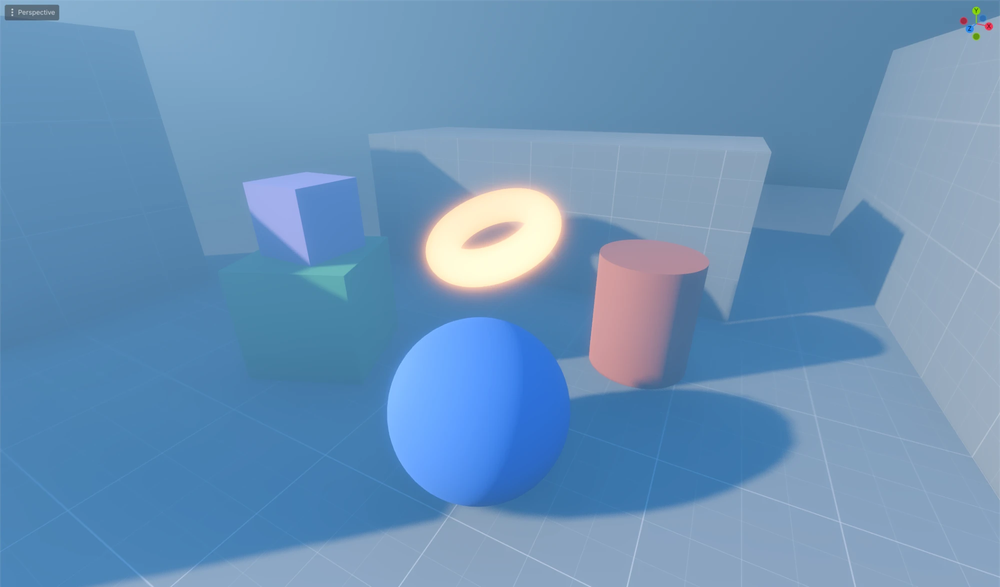 | 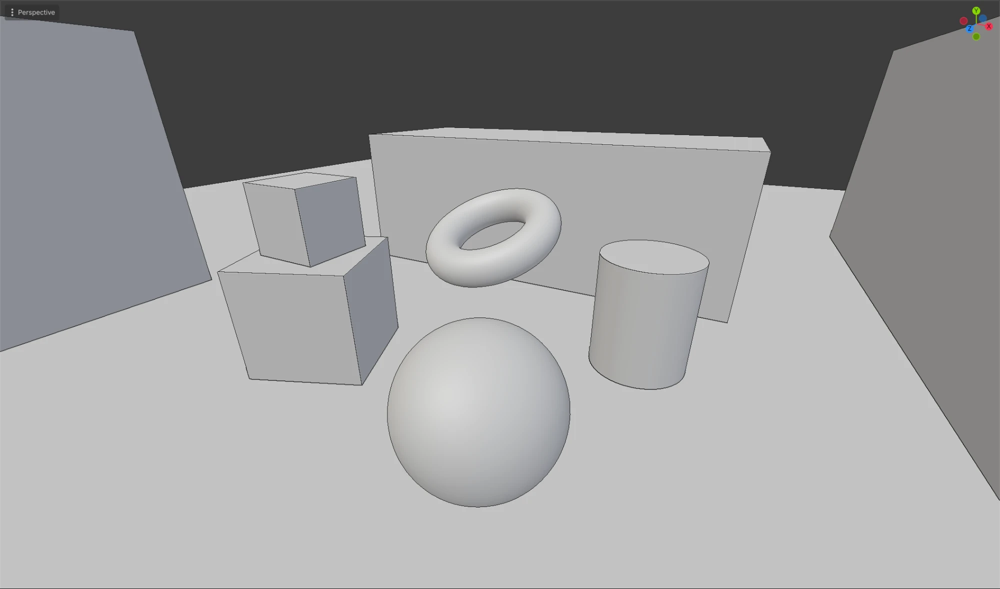 |
| **Texture colour** | **X-ray** |
| 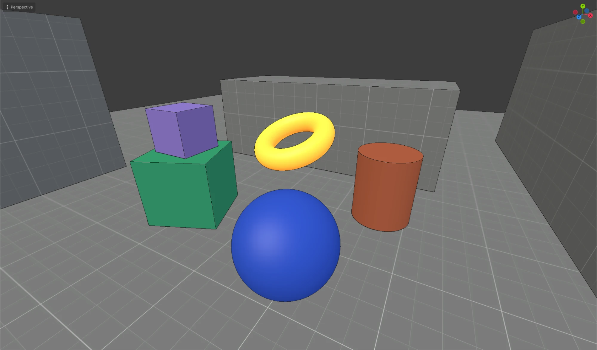 | 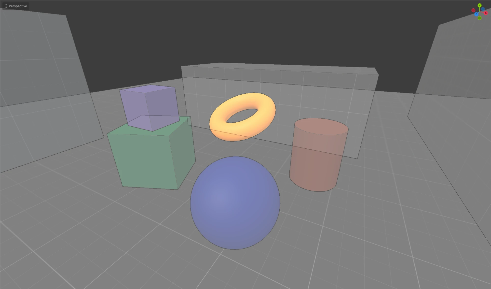 |
| **Normal matcap** | **Contrast matcap** |
| 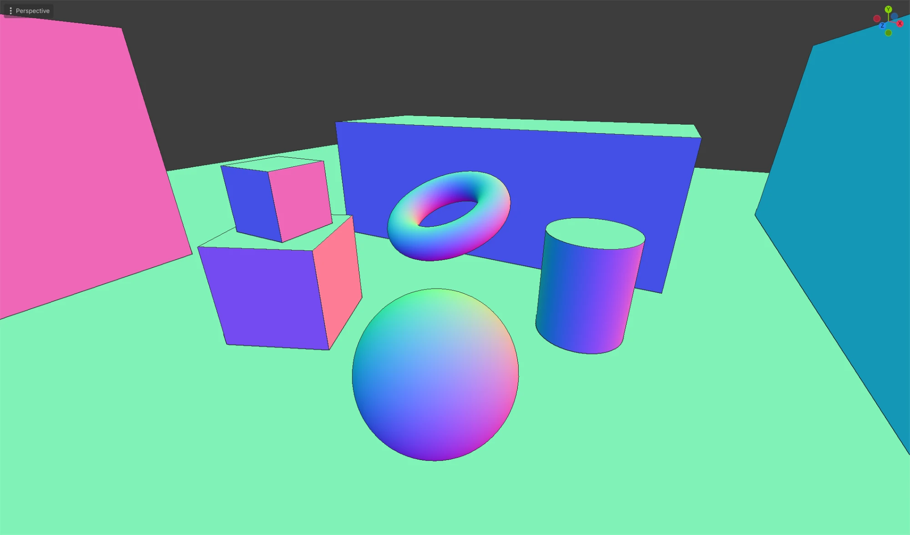 | 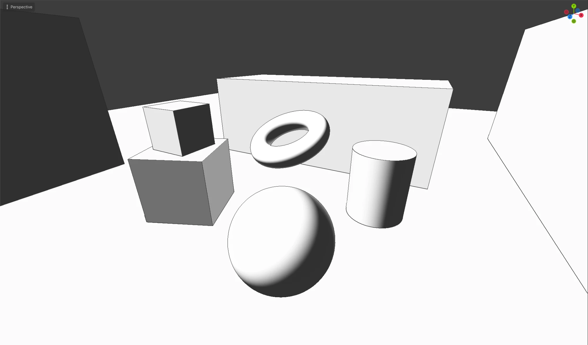 |

**Status: 1.3.0.** Forward+ only. Issues and pull requests are welcome; please say which Godot version and platform you're on.

## What it does

- **Workbench** toggle in the 3D toolbar, **Alt+Z** (Option+Z on macOS) by default, rebindable under `workbench/toggle` in Editor Settings > Shortcuts.
- **Studio lighting**: a warm key, a cool fill and a faint rim, fixed to the view, so nothing is ever in the dark.
- **MatCap**: a sphere image sampled by view-space normal. Seven are bundled, under **Bundled MatCaps**, and **Choose MatCap…** takes any image in the project, including the `.exr` matcaps that ship with Blender.

  | Clay | Normal | Contrast | Toon | Zebra | Wax | Chrome |
  | --- | --- | --- | --- | --- | --- | --- |
  | 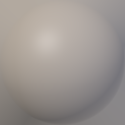 | 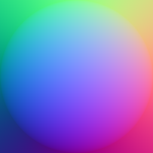 | 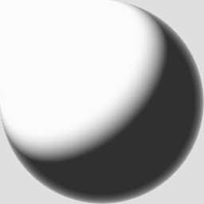 | 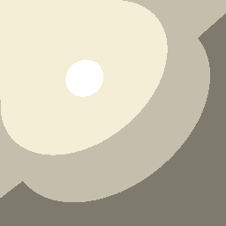 | 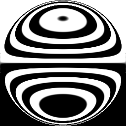 | 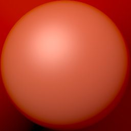 | 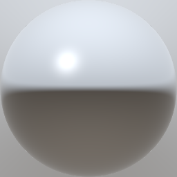 |

  Clay matches the studio light. Normal colours each surface by the direction it faces, as a normal map would, so facing up is green, right is pink and towards you is lavender. Contrast is two tones with a thin rim. Toon is three cel bands with a specular dot. Zebra reflects a striped room, so a smooth surface shows smooth stripes and a kink breaks them. Wax is red sculpting wax. Chrome reflects a bright sky over a dark floor.
- **Flat or texture colour**: a plain grey, or each surface's own albedo (the viewport draws unshaded underneath, so textures show but scene lights don't).
- **Cavity**: screen-space ridges brighten and valleys darken, as Blender's *Screen* cavity does.
- **Outline**: a dark line where a surface drops away to something farther, or to the sky. Its width is `workbench/outline_width` in Editor Settings, in points, so it looks the same on any display.
- **Crease Lines**: with Outline on, also a line along sharp creases within a surface, where neighbouring normals differ by more than 45 degrees. Blender has no such line; its creases show through Cavity only.
- **X-ray**: see through the front surfaces to what is behind them, as Blender's X-ray does. **Alt+Shift+Z** by default (`workbench/toggle_xray`); the front surface's opacity is `workbench/xray_alpha` in Editor Settings. Alt+click in the viewport lists everything under the cursor, so hidden objects can be picked.
- The editor's grid, gizmos, selection outline and any transparent objects still draw on top, as they would normally.
- Nothing in the scene is touched. The addon only sets the editor cameras' environment and compositor and the editor viewports' debug draw, and only while a frame is being drawn; MSAA is off on the editor viewports for as long as the mode is on. Everything is put back when it's switched off or disabled.

## Requirements

Godot 4.7 or later, with the **Forward+** renderer: the shading reads the normal and roughness buffer that only Forward+ writes. Pure GDScript and one compute shader; no C# or GDExtension.

## Install

1. Copy `addons/workbench/` into your project's `addons/` folder. From a clone of this repo, `tools/sync_to.sh /path/to/your/project` does that and removes stale files from an older copy.
2. Open **Project → Project Settings → Plugins** and enable **Workbench**.
3. A **Workbench** toggle and an options menu appear at the right of the 3D viewport's toolbar.

## Options

The menu next to the toggle:

| Option | Effect |
| --- | --- |
| Studio Lighting / MatCap | How surfaces are shaded. |
| Flat Colour / Texture Colour | A plain grey, or each surface's albedo. |
| Cavity | Ridges and valleys from the normals. |
| Outline | Dark edge where depth jumps. |
| Crease Lines | Also a line along creases sharper than 45 degrees. |
| X-Ray | Front surfaces half transparent, geometry behind them ghosted. |
| Bundled MatCaps | Clay, Normal, Contrast, Toon, Zebra, Wax or Chrome; switches to MatCap. |
| Choose MatCap… | Pick an image from the project; switches to MatCap. |

Editor Settings > Workbench holds the rest: the outline width in points, and the x-ray opacity. Changes there apply at once.

Options are Editor Settings (`workbench/…`), so they follow you between projects. The toggle itself starts off every session.

## How it works

A `CompositorEffect` on each editor camera runs a compute shader after the opaque pass and before the sky: for every pixel with depth, it reads the view-space normal from the normal and roughness buffer and writes studio or matcap shading over the colour buffer. Because that happens before the transparent pass, gizmos and see-through objects land on top. The camera also gets a neutral `Environment`, which removes fog, glow and tonemapping and makes sure the depth prepass writes normals at all.

MSAA is switched off on the editor viewports while the mode is on: with MSAA, the colour buffer is only resolved after the transparent pass, so a post-opaque write would be thrown away. TAA and FXAA still apply.

X-ray needs what the opaque pass throws away: the geometry behind the front surface. For it, each editor viewport gets a hidden child viewport that renders the same world from a copy of the editor camera in the editor's Overdraw debug draw, which draws every surface regardless of depth as a fixed amount of colour. That gives the number of surfaces under each pixel, and the shader blends the front shading over that many ghosted layers over the background, with a faint line wherever the count changes: the silhouettes of what is hidden. A child viewport renders before its parent, so the count is from the same frame.

## Limitations

- Forward+ only. Mobile and Compatibility have no normal buffer for a compositor effect to read.
- Objects whose material skips the depth prepass (transparent, `depth_draw_never`) keep their own look.
- The outline is depth-based, not object-based: two touching objects at the same depth have no line between them.
- X-ray knows how many surfaces are behind a pixel, not what they look like, so hidden geometry is a flat ghost with silhouette lines rather than shaded as Blender draws it. It costs a second, unshaded render of the scene per editor viewport.
- The View menu's **View Environment** toggle has no visible effect while Workbench is on; its setting is kept and comes back when Workbench is off.

## Licence

MIT. See [LICENSE](LICENSE).

## AI disclosure

Claude Code was used to assist in the research and writing of code.
