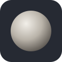
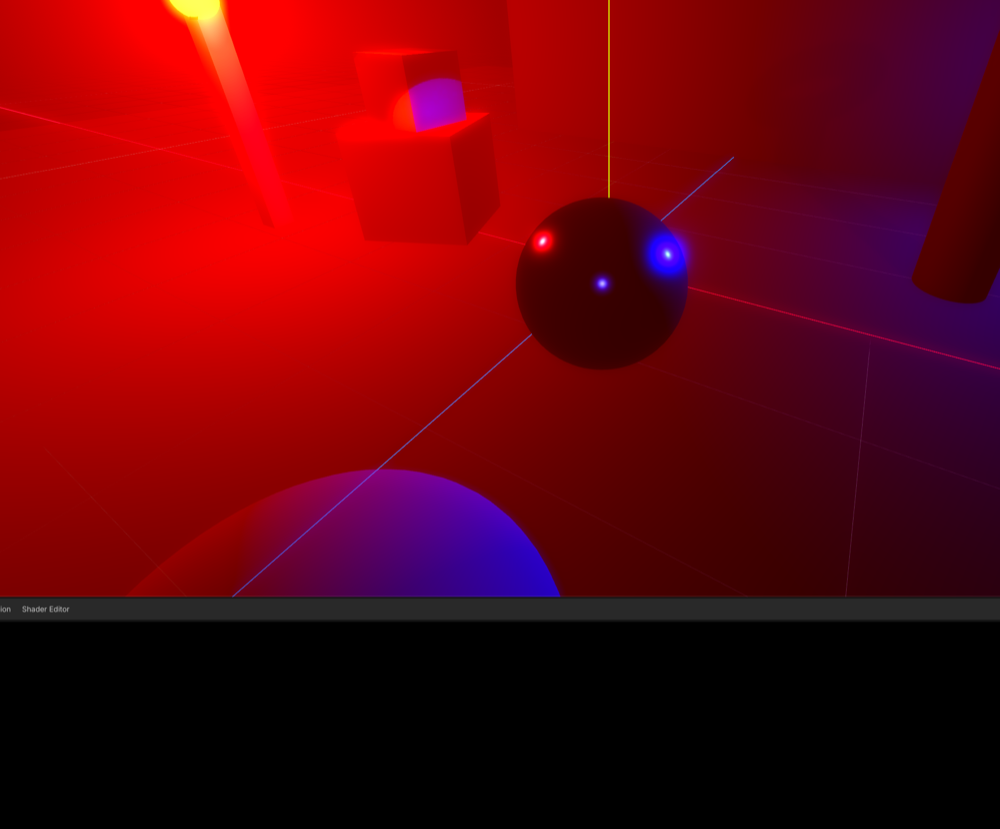
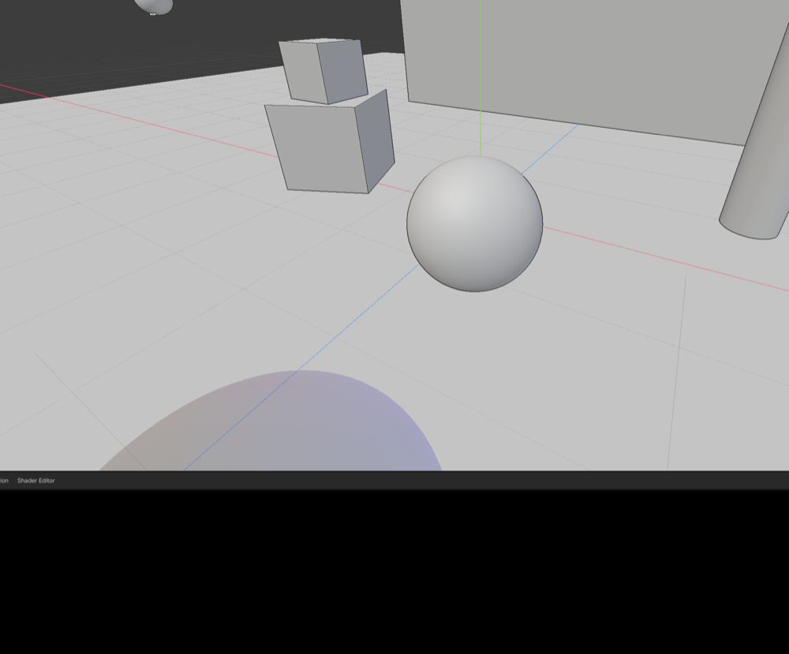
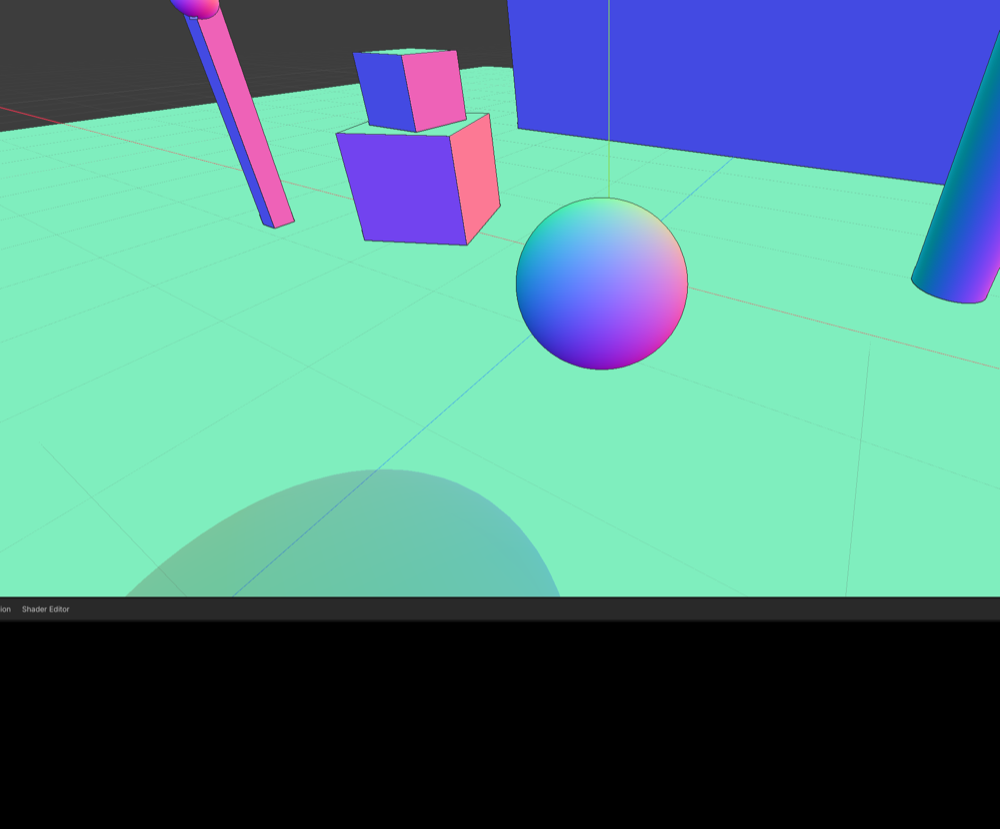
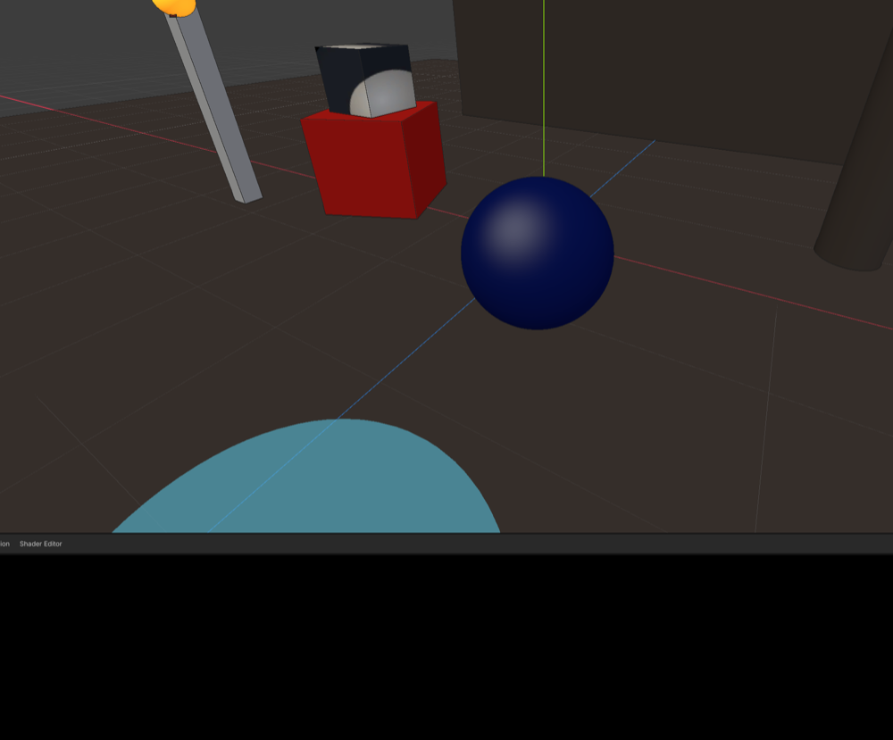

#  Solid View

A Godot 4.7+ editor addon that gives the 3D viewport a shading mode like Blender's **Solid** mode: every surface lit by a fixed studio light or a matcap, with the scene's lights, fog, glow, ambient and tonemapping out of the way. For laying out levels in a scene whose real lighting is dark, foggy or otherwise hard to see through.

| Scene as lit | Solid, studio lighting |
| --- | --- |
|  |  |
| **Solid, matcap** | **Solid, studio with texture colour** |
|  |  |

**Status: 1.0.1.** Forward+ only. In daily use on one game project. Issues and pull requests are welcome; please say which Godot version and platform you're on.

## What it does

- **Solid** toggle in the 3D toolbar, **Alt+Z** (Option+Z on macOS) by default, rebindable under `solid_view/toggle` in Editor Settings > Shortcuts.
- **Studio lighting**: a warm key, a cool fill and a faint rim, fixed to the view, so nothing is ever in the dark.
- **MatCap**: a sphere image sampled by view-space normal. A clay one is bundled; **Choose MatCap…** takes any image in the project, including the `.exr` matcaps that ship with Blender.
- **Flat or texture colour**: a plain grey, or each surface's own albedo (the viewport draws unshaded underneath, so textures show but scene lights don't).
- **Cavity**: screen-space ridges brighten and valleys darken, as Blender's *Screen* cavity does.
- **Outline**: a dark line where a surface drops away to something farther, or to the sky.
- The editor's grid, gizmos, selection outline and any transparent objects still draw on top, as they would normally.
- Nothing in the scene is touched. The addon only sets the editor cameras' environment and compositor and the editor viewports' debug draw, and only while a frame is being drawn; MSAA is off on the editor viewports for as long as the mode is on. Everything is put back when it's switched off or disabled.

## Requirements

Godot 4.7 or later, with the **Forward+** renderer: the shading reads the normal and roughness buffer that only Forward+ writes. Pure GDScript and one compute shader; no C# or GDExtension.

## Install

1. Copy `addons/solid_view/` into your project's `addons/` folder. From a clone of this repo, `tools/sync_to.sh /path/to/your/project` does that and removes stale files from an older copy.
2. Open **Project → Project Settings → Plugins** and enable **Solid View**.
3. A **Solid** toggle and an options menu appear at the right of the 3D viewport's toolbar.

## Options

The menu next to the toggle:

| Option | Effect |
| --- | --- |
| Studio Lighting / MatCap | How surfaces are shaded. |
| Flat Colour / Texture Colour | A plain grey, or each surface's albedo. |
| Cavity | Ridges and valleys from the normals. |
| Outline | Dark edge where depth jumps. |
| Choose MatCap… | Pick an image from the project; switches to MatCap. |
| Use Bundled MatCap | Back to the clay matcap. |

Options are Editor Settings (`solid_view/…`), so they follow you between projects. The toggle itself starts off every session.

## How it works

A `CompositorEffect` on each editor camera runs a compute shader after the opaque pass and before the sky: for every pixel with depth, it reads the view-space normal from the normal and roughness buffer and writes studio or matcap shading over the colour buffer. Because that happens before the transparent pass, gizmos and see-through objects land on top. The camera also gets a neutral `Environment`, which removes fog, glow and tonemapping and makes sure the depth prepass writes normals at all.

MSAA is switched off on the editor viewports while the mode is on: with MSAA, the colour buffer is only resolved after the transparent pass, so a post-opaque write would be thrown away. TAA and FXAA still apply.

## Limitations

- Forward+ only. Mobile and Compatibility have no normal buffer for a compositor effect to read.
- Objects whose material skips the depth prepass (transparent, `depth_draw_never`) keep their own look.
- The outline is depth-based, not object-based: two touching objects at the same depth have no line between them.
- The View menu's **View Environment** toggle has no visible effect while Solid is on; its setting is kept and comes back when Solid is off.

## Licence

MIT. See [LICENSE](LICENSE).
